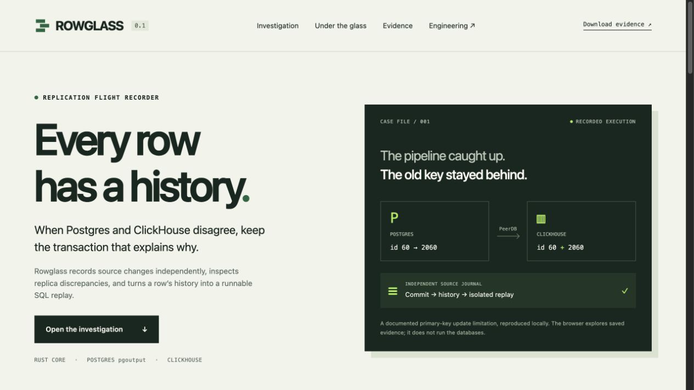

# Rowglass

**A replication flight recorder for Postgres → ClickHouse.** Keep committed source history, inspect a discrepant row, and export a small SQL workload another engineer can run.



Rowglass is an independent working prototype by Ivan Balkashynov. It combines a Rust evidence engine, a PostgreSQL logical-replication recorder, a ClickHouse adapter, a transaction-preserving replay compiler and a portable investigation UI. It is useful when a table diff shows a discrepancy but the transaction history needed to explain it has disappeared.

## Start with the case

The recorded lab contains **104 committed transactions and 205 changes** through real Postgres 17, PeerDB stable-v0.37.10 and ClickHouse 26.8.2.7. Changing primary key `60` to `2060` left both keys in the replica. Rowglass extracted **two transactions and one baseline row**, then reproduced the behavior through a fresh PeerDB mirror. This is a [documented default limitation](https://clickhouse.com/docs/integrations/clickpipes/postgres/faq#can-i-update-primary-key-columns-in-postgresql), not a new bug claim.

Six browser scenarios expose healthy state, induced lag, the key change, explicit alignment, three deliberately injected destination faults and restoration to **2,099 matching rows**. Values, history, checkpoint evidence, SQL and raw audit JSON are inspectable. The browser explores recorded execution; it does not run databases.

Open `index.html` in the separate demo package, or generate it from this source checkout:

```sh
python3 -m venv .venv
.venv/bin/pip install -e .
cargo build --release --locked
.venv/bin/python scripts/build_demo.py
python3 -m http.server 58731 --bind 127.0.0.1 --directory demo
```

Visit http://127.0.0.1:58731. Rust 1.88+ and Python 3.11+ are required for the engine; validation used Rust 1.93 / Python 3.13 on Apple Silicon. The prebuilt demo needs only a browser. Installation is from the source checkout using editable mode; the native executable and web assets remain beside the Python package.

## What it actually does

- Bootstraps from an exported source snapshot, decodes real protocol-v1 `pgoutput`, and syncs a checksummed journal before acknowledging WAL.
- Resumes after a capture-process crash and refuses missing WAL, source identity changes, unsealed baselines and complete corrupt journal frames.
- Reconstructs exact typed state and row histories, including unchanged TOAST, key changes, deletes and truncates.
- Reads visible latest ClickHouse versions, applies tombstones, and rejects conflicting maximum-version ties.
- Separates a live observation from an explicitly controlled comparison cut. A live mismatch is never a permanent-loss verdict.
- Compiles backward row lineage into a fresh-schema replay, preserving complete selected transactions and companion writes across tables.

## Reproduce and inspect

```sh
cargo test --locked
.venv/bin/python -m unittest discover -s tests -p 'test_*.py' -v
.venv/bin/python scripts/verify_evidence.py
```

For the live laboratory, allocate at least 8 GB to Docker and start a **fresh Rowglass lab**:

```sh
docker compose -f compose.yaml -f lab/pipeline.yaml up -d
.venv/bin/python scripts/wait_lab.py
.venv/bin/python lab/bootstrap.py
.venv/bin/python lab/scenarios.py
.venv/bin/python tests/real_capture.py
```

Bootstrap deliberately fails if its source tables already exist. Scenarios mutate only the dedicated lab. See [operations](docs/OPERATIONS.md) for ports, restart, cleanup, credentials and recording your own pipeline. Real runs are stored under `runs/`; frozen synthetic evidence ships under `evidence/`.

## Engineering evidence

| Result | Evidence |
| --- | --- |
| Six pipeline scenarios passed | [Verification](evidence/pipeline/verification.json) |
| Two-transaction replay through a separate real mirror | [Replay result](evidence/pipeline/key-replay-verification.json), [SQL](evidence/pipeline/key-replay.sql) |
| Snapshot, types, TOAST, crash/resume and ACK boundary | [Source capture verification](evidence/capture/verification.json) |
| 100,000-row audit: 0.444 s median, 197.6 MiB peak RSS | [Measurements](evidence/benchmark.json) |
| Restricted Python reference: 0.298 s, 256.0 MiB | Same fixture and measurements; faster than native at this size |

Read the [engineering brief](docs/ENGINEERING.md), [design contracts](docs/DESIGN.md) and [validation details](docs/VALIDATION.md). Performance measurements include reconstruction and comparison, not network transport or ingest throughput. The lab uses local open-source PeerDB, not hosted ClickPipes.

## Boundaries

This is a bounded investigation tool, not a production replication service. It needs a recording before the incident, retains full reconstructed state in memory, performs one journal sync per commit, and limits replay input to 256 MiB. It supports regular tables with stable explicit primary keys and a fixed, unfiltered publication. DDL, failover, partitioning, arbitrary custom types, redaction and distributed/sharded target semantics need more work. A replay is a backward row-dependency slice, not a proven minimum failure case or the original application SQL.

For a one-time reconciliation without source history, use a table-diff tool. For operating the pipeline, use PeerDB/ClickPipes and their monitoring. Rowglass's hypothesis is that an independent history and portable replay shorten a subsequent correctness investigation; user adoption has not been measured.

MIT for Rowglass code. Third-party services retain their own licenses; see [notices](THIRD_PARTY.md).
